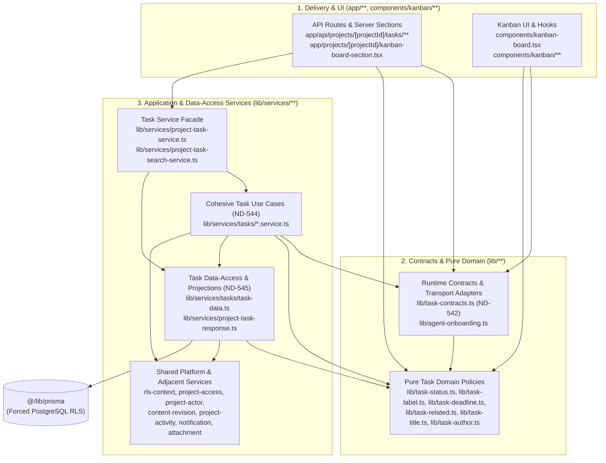
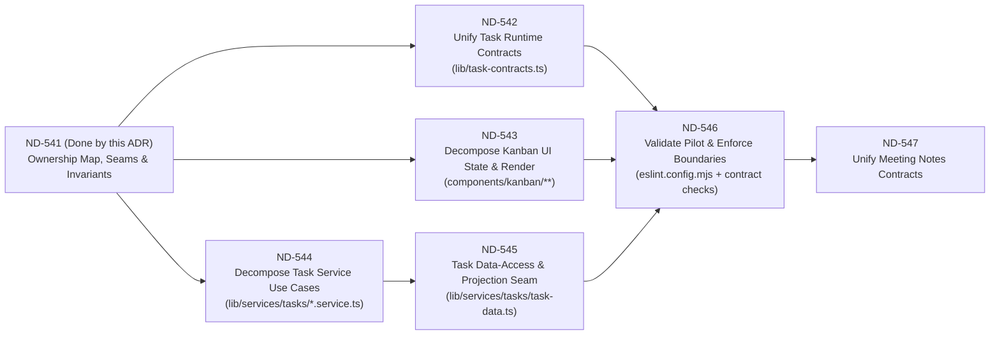

# ND-541: Tasks/Kanban Domain Boundary and Staged Modular-Monolith Seams

- **Date:** 2026-10-30
- **Status:** Accepted
- **Epic:** `cmuub2cab000k04l2uxmve21b` (`Strengthen modular monolith boundaries`)
- **Card:** `ND-541` (`cmuub4jf1000r04l22ykz1feb`)
- **Downstream Cards:** `ND-542`, `ND-543`, `ND-544`, `ND-545`, `ND-546`, `ND-547`
- **Related ADRs:** `adr/nd-187-shared-discussion.md`, `adr/nd-455-rls-safe-actor-projections.md`, `adr/decisions.md`

---

## 1. Decision Summary

Establish an explicit **Tasks/Kanban domain ownership map**, **public import seams**, **selected software design patterns**, **behavior and security invariants**, and a **staged, rollback-safe extraction plan** for the modular-monolith pilot (`ND-541` through `ND-546`).

Key architectural decisions:

1. **Preserve the repository-wide service/persistence boundary:** All `@/lib/prisma` access remains inside `lib/services/**` (enforced by `eslint.config.mjs`). We explicitly reject a full top-level folder migration (such as moving services out of `lib/services/**` into `domains/tasks/**`) in favor of cohesive, domain-owned modules within existing top-level directories (`components/kanban/**`, `lib/task-*.ts`, and `lib/services/tasks/**` behind existing service entry points).
2. **Use targeted structural and behavioral design patterns with low ceremony:**
   - **Facade (`lib/services/project-task-service.ts`, `lib/services/project-service.ts` compatibility re-exports):** Keep existing service entry points stable while internal use cases (`ND-544`) and data-access projections (`ND-545`) are extracted.
   - **Transport Adapter + Command (`lib/task-contracts.ts` in `ND-542`):** Adapt heterogeneous HTTP inputs (`application/json` in single/bulk routes and `multipart/form-data` in task create) into canonical validated command objects before invoking application services, and derive/align agent OpenAPI documentation (`lib/agent-onboarding.ts`) from the same contract rules.
   - **Focused Data-Access / Query & Projection Seam (`lib/services/tasks/task-data.ts` or cohesive `lib/services/tasks/*-data.ts` in `ND-545`):** Consolidate multi-relation Prisma `include`/`select` shapes, position/relation SQL helpers, and lazy `Done`-task archiving behind internal functions that **require an explicit `db: DbClient`** (never defaulting to the global `prisma` client, which would bypass the transaction-local `app.user_id` GUC established by `withActorRlsContext`). Public service entry points establish `withActorRlsContext` and pass its scoped `db` client into `task-data.ts`, creating a single persistence seam for future field-level encryption (`cmu389cd9000104jvk1bbipyf`) without introducing generic pass-through repositories.
   - **Focused Hook / Controller Composition (`components/kanban/hooks/**` in `ND-543`):** Decompose `components/kanban-board.tsx` around stateful behavioral responsibilities (board columns & realtime reconciliation, pointer/keyboard drag-and-drop with version-fenced settlement, task detail selection & URL history sync, and task edit/live-save/recovery orchestration) rather than mechanical line-count slicing or a heavy class-based mediator.
3. **Decouple downstream pilot cards so work can proceed in parallel with clear contracts:**
   - `ND-542` (runtime contracts & OpenAPI alignment), `ND-543` (Kanban UI state/render decomposition), and `ND-544` (Task service use-case decomposition) can proceed independently against the seams defined here.
   - `ND-545` (Task data-access layer & moving misplaced Task queries out of `lib/services/project-service.ts`) sequences cleanly with `ND-544` behind the `lib/services/project-task-service.ts` and `lib/services/project-service.ts` facades.
   - `ND-546` validates the completed Tasks pilot, adds targeted boundary checks, and gates `ND-547` (Meeting Notes contract unification).

---

## 2. Context and Baseline Verification

Verified against `origin/main` (`b6351a2`):

- **Monolithic UI controller:** `components/kanban-board.tsx` is **4,352 lines** (`167 KB`) and `components/kanban/task-detail-modal.tsx` is **2,554 lines** (`103 KB`). While pure helpers (`components/kanban-board-utils.ts`, `components/kanban-board-task-commands.ts`, `components/kanban-board-related.ts`, `components/kanban-board-comments.ts`) and presentational subtrees (`components/kanban/kanban-columns-grid.tsx`, `components/kanban/kanban-filter-bar.tsx`) were previously extracted, `KanbanBoard` still owns six distinct stateful lifecycles in a single component scope.
- **Monolithic application service:** `lib/services/project-task-service.ts` is **2,397 lines** (`78 KB`). It mixes request payload validation (`validateTaskCreateFieldTypes`, `parseTaskAssigneeInput`, `parseDeadlineInput`, `isValidReorderPayload`, `isTaskStatusTransitionPayload`), authorization and policy checks (`requireAgentDoneMoveCapability`, `validateRelatedTaskIds`, `validateEpicId`, `resolveTaskAssigneeAssignment`, `resolveTaskAgentAttribution`), side-effect orchestration (activity events, content revisions, assignee audit logs, human notifications, attachment storage cleanup), and raw Prisma relation/position queries (`loadTaskMutationPayload`, `replaceTaskRelations`, `editTaskRelationPairs`).
- **Scattered contract parsing:** Task creation and update rules are duplicated or split across `app/api/projects/[projectId]/tasks/route.ts` (JSON + `multipart/form-data`), `app/api/projects/[projectId]/tasks/[taskId]/route.ts` (`PATCH` with `X-Content-If-Match`), `app/api/projects/[projectId]/tasks/bulk/route.ts` (which re-serializes fields and adapts payloads to `createTaskForProject` / `updateTaskForProject`), `lib/services/project-task-service.ts`, and manual OpenAPI descriptions in `lib/agent-onboarding.ts`.
- **Misplaced Task read/projection logic in `project-service.ts`:** `lib/services/project-service.ts` (lines 19–105, 455–490, 651–778) currently owns `projectKanbanTaskInclude`, `ProjectKanbanTaskRecord`, `archiveStaleDoneTasks`, `TaskListAssigneeFilter`, `TaskListFilters`, `listProjectKanbanTasks`, and `getProjectKanbanTaskById`. Meanwhile, `lib/services/project-task-service.ts` maintains its own `loadTaskMutationPayload` projection with an almost identical relation shape.
- **Duplicate response-to-UI normalization:** `app/projects/[projectId]/kanban-board-section.tsx` manually maps `ProjectKanbanTaskRecord` into client `KanbanTask` objects in parallel with `mapProjectKanbanTaskToTaskResponse` in `lib/services/project-task-response.ts` and `normalizeTaskFromResponse` in `components/kanban-board-utils.ts`.
- **Enforced repository guardrails:** `eslint.config.mjs` enforces that `@/lib/prisma` may only be imported within `lib/services/**` (and `lib/auth.ts`, `lib/prisma.ts`). Additionally, PostgreSQL Row-Level Security (`prisma/rls-inventory.json`) is forced on all Task tables and requires every database operation to execute within `withActorRlsContext`.

---

## 3. Domain Ownership Map and Public Import Seams (AC1)

### 3.1 Layer and Module Ownership Inventory

The Tasks/Kanban domain is organized into six vertical layers inside the existing repository structure, plus explicit boundaries with genuinely shared infrastructure and adjacent domains:

| Layer | Current Modules | Target / Extracted Modules (`ND-542`–`ND-545`) | Domain Owner | Public Import Seam (Allowed Consumers) |
| --- | --- | --- | --- | --- |
| **1. Routes & Server Entry Points (`app/`)** | `app/projects/[projectId]/kanban-board-section.tsx` `app/projects/[projectId]/tasks/[taskId]/page.tsx` `app/api/projects/[projectId]/tasks/route.ts` `app/api/projects/[projectId]/tasks/[taskId]/route.ts` `app/api/projects/[projectId]/tasks/[taskId]/status/route.ts` `app/api/projects/[projectId]/tasks/[taskId]/archive/route.ts` `app/api/projects/[projectId]/tasks/reorder/route.ts` `app/api/projects/[projectId]/tasks/bulk/route.ts` `app/api/projects/[projectId]/tasks/search/route.ts` | Thin route handlers parsing HTTP transport via `lib/task-contracts.ts` (`ND-542`) and delegating to `lib/services/project-task-service.ts` | **Tasks HTTP / RSC Delivery** | Next.js App Router runtime only. Never imported by `components/**` or `lib/**`. |
| **2. UI Components, Hooks & Client State (`components/`)** | `components/kanban-board.tsx` `components/create-task-dialog.tsx` `components/kanban-board-types.ts` `components/kanban-board-utils.ts` `components/kanban-board-task-commands.ts` `components/kanban-board-related.ts` `components/kanban-board-comments.ts` `components/kanban/task-detail-modal.tsx` `components/kanban/kanban-columns-grid.tsx` `components/kanban/kanban-filter-bar.tsx` `components/kanban/kanban-filter-utils.ts` `components/kanban/related-task-field.tsx` `components/kanban/attachment-file-list.tsx` `components/kanban/task-comment-body.tsx` `components/kanban/image-attachment-grid.tsx` `components/kanban/use-kanban-task-search.ts` `components/kanban/kanban-board-header.tsx` `components/kanban/copy-task-link-button.tsx` `components/kanban/task-deadline-field.tsx` `components/kanban/task-status-presentation.ts` | Focused Kanban controller hooks & subtrees under `components/kanban/**` (`ND-543`), e.g.: - `use-kanban-board-columns.ts` (lanes, archive state, remote activity/prop reconciliation) - `use-kanban-drag-drop.ts` (pointer & keyboard DnD, version-fenced settlement) - `use-kanban-task-selection.ts` (active task, URL `taskId` sync, fallback fetch, focus restoration) - `use-kanban-task-editor.ts` (edit draft, `useRecoveryDraft`, `useLiveSave`, field command diffs) - `use-kanban-task-discussion.ts` (comments, reactions, attachment upload/delete state in modal) | **Tasks / Kanban UI** | `app/projects/[projectId]/kanban-board-section.tsx` imports `KanbanBoard` (`components/kanban-board.tsx`) and `KanbanTask` (`components/kanban-board-types.ts`). Internal `components/kanban/**` modules are private to the Kanban UI subtree except explicitly shared UI primitives. |
| **3. Runtime Contracts & API Schemas (`lib/`)** | Scattered across `app/api/projects/[projectId]/tasks/**`, `lib/task-bulk.ts`, `lib/services/project-task-service.ts`, and `lib/agent-onboarding.ts` | `lib/task-contracts.ts` (`ND-542`) owning canonical create/update/status/reorder runtime schemas, JSON & `FormData` transport adapters, inferred command types, and OpenAPI schema descriptors consumed by `lib/agent-onboarding.ts` | **Tasks Contract Layer** | Imported by `app/api/projects/[projectId]/tasks/**`, `lib/services/project-task-service.ts` (and `lib/services/tasks/**`), `lib/agent-onboarding.ts`, and contract tests. |
| **4. Pure Domain Policies & Value Objects (`lib/`)** | `lib/task-status.ts` `lib/task-label.ts` `lib/task-deadline.ts` `lib/task-related.ts` `lib/task-title.ts` `lib/task-reference.ts` `lib/task-author.ts` `lib/task-bulk.ts` `lib/task-comment.ts` `lib/task-url.ts` `lib/task-open-client.ts` *(Cross-domain shared value helpers currently named `task-*`: `lib/task-person.ts`, `lib/task-attachment.ts` — see §3.2)* | Keep pure and side-effect-free (no I/O, no Prisma, no `next/headers`). | **Tasks Domain Model** | Safe for both client (`components/**`) and server (`app/**`, `lib/services/**`) imports. |
| **5. Application Use-Case Services (`lib/services/`)** | `lib/services/project-task-service.ts` `lib/services/project-task-search-service.ts` | `lib/services/project-task-service.ts` remains the **public Facade** re-exporting stable entry points (`ND-544`), backed by cohesive internal modules under `lib/services/tasks/**`: - `task-create-update.service.ts` (create, patch, assignee/epic/relation/blocked-note policies, revision lock, notifications) - `task-ordering-status.service.ts` (`moveTaskStatusForProject`, `reorderProjectTasks`, `archiveTaskForProject`, `unarchiveTaskForProject`, agent Done-move policy) - `task-delete.service.ts` (`deleteTaskForProject` + post-commit storage cleanup) - `task-actor-attribution.ts` (agent credential snapshot & assignee resolution helpers) | **Tasks Application Layer** | `app/api/projects/[projectId]/tasks/**` and `app/projects/[projectId]/kanban-board-section.tsx` import from `lib/services/project-task-service.ts` (and `lib/services/project-task-search-service.ts`). External callers must **not** deep-import `lib/services/tasks/**`. |
| **6. Task Data-Access, Projections & Response Mapping (`lib/services/`)** | `lib/services/project-task-response.ts` Misplaced in `lib/services/project-service.ts`: - `projectKanbanTaskInclude` - `ProjectKanbanTaskRecord` - `archiveStaleDoneTasks` - `listProjectKanbanTasks` - `getProjectKanbanTaskById` Inline in `lib/services/project-task-service.ts`: - `loadTaskMutationPayload` - `replaceTaskRelations` / `editTaskRelationPairs` | Extracted in `ND-545` into `lib/services/tasks/task-data.ts` (or split into `task-queries.ts` + `task-mutations-data.ts` under `lib/services/tasks/**`) + `lib/services/project-task-response.ts`. `lib/services/project-service.ts` retains thin `@deprecated` compatibility re-exports for `listProjectKanbanTasks`, `getProjectKanbanTaskById`, `archiveStaleDoneTasks`, and `ProjectKanbanTaskRecord` until all callers migrate. | **Tasks Persistence & Projection Layer** | Consumed by `lib/services/tasks/**` and `lib/services/project-task-service.ts`. Internal data helpers **require an explicit `db: DbClient`** (no global `prisma` default) so they always execute on the caller's `withActorRlsContext` connection/transaction; public read wrappers establish `withActorRlsContext` when needed and pass `db` down. |

### 3.2 Adjacent Domains and Genuinely Shared Modules

To avoid false coupling or premature merges, the following modules have explicit ownership boundaries outside core Task CRUD/Kanban state:

1. **Task Discussion (`app/api/projects/[projectId]/tasks/[taskId]/comments/**`, `lib/services/project-task-comment-service.ts`, `lib/task-comment.ts`):**
   - **Owner:** Task Discussion / Shared Discussion boundary (`adr/nd-187-shared-discussion.md`).
   - **Seam:** `KanbanBoard` and `TaskDetailModal` interact with comments via HTTP endpoints and pure types/helpers (`lib/task-comment.ts`, `components/kanban-board-comments.ts`). `lib/services/project-task-service.ts` only reads comment counts and attachment summaries through the shared task read projection (`projectKanbanTaskInclude`). `ND-541`–`ND-545` must **not** fold `project-task-comment-service.ts` into `project-task-service.ts`.
2. **Attachments (`app/api/projects/[projectId]/tasks/[taskId]/attachments/**`, `lib/services/project-attachment-service.ts`, `lib/services/attachment-input-service.ts`, `lib/task-attachment.ts`):**
   - **Owner:** Project Attachment Service (shared across Tasks, Context Cards, and Comments).
   - **Seam:** `lib/task-attachment.ts` exports attachment constants (`ATTACHMENT_KIND_*`, `MAX_TASK_ATTACHMENT_SIZE_BYTES`, `DIRECT_UPLOAD_MAX_ATTACHMENT_SIZE_BYTES`, MIME validation) that are also imported by `components/project-context-panel.tsx` and `lib/services/project-attachment-service.ts`. Keep `lib/task-attachment.ts` as a stable public module (do not rename or break its exports during the Tasks pilot). On task creation/deletion, `project-task-service.ts` delegates attachment storage writes/deletes to `project-attachment-service.ts` and `attachment-input-service.ts`.
3. **Person & Actor Summaries (`lib/task-person.ts`, `lib/project-actor.ts`, `lib/services/project-actor-service.ts`, `lib/services/project-task-response.ts`):**
   - **Owner:** Shared Project Actor / Identity projection (`adr/nd-455-rls-safe-actor-projections.md`).
   - **Seam:** `lib/task-person.ts` (`TaskPersonSummary`, `mapTaskPersonSummary`) is imported by `lib/services/project-service.ts` and `lib/services/project-epic-response.ts`. Similarly, `mapTaskStoredActor` in `lib/services/project-task-response.ts` is imported by `lib/services/project-agent-attention-service.ts`. Both exports must remain backward-compatible public seams.
4. **Epics & Roadmap (`lib/services/project-epic-service.ts`, `lib/project-epic.ts`):**
   - **Owner:** Epics / Roadmap domain.
   - **Seam:** Tasks reference `epicId` and project a lightweight `{ id, title, status }` epic summary on task reads. When the Roadmap UI reconciles epics, it dispatches the browser custom event `PROJECT_EPICS_RECONCILED_EVENT` (`lib/project-epic-events.ts`), which `KanbanBoard` listens to in order to update epic badges/filters without coupling component trees.
5. **Cross-Cutting Platform Services (`lib/services/**` & `lib/`):**
   - `lib/services/rls-context.ts` (`withActorRlsContext`, `DbClient`)
   - `lib/services/project-access-service.ts` (`requireProjectRole`, `requireAgentProjectScopes`)
   - `lib/content-revision.ts` (`parseContentPrecondition`, `parseContentIfMatch`, `withContentEtag`, `contentErrorBody`) & `lib/services/content-revision-service.ts` (`lockContentRevision`, `editConflict`)
   - `lib/services/project-activity-service.ts` (`recordProjectActivityEvent`, `touchProjectActivity`), `lib/project-activity-event-response.ts` (`recordProjectActivityEventVersion`), & `lib/project-activity-version.ts` (`withProjectActivityVersionHeader`)
   - `lib/services/notification-service.ts` (`createTaskAssignmentNotification`, `resolveTaskAssignmentNotifications`)
   - `lib/services/transaction-retry.ts` (`retryTransaction`, `isRetryableTransactionError`)
   - `lib/rich-text.ts` (`sanitizeRichText`, `extractPlainTextFromRichText`, `hasMeaningfulRichTextContent`)

### 3.3 Dependency Direction Rules

**Strict Import Invariants (to be codified in `ND-546`):**
1. `@/lib/prisma` is **only** imported in `lib/services/**` (`eslint.config.mjs`). Within the Tasks domain after `ND-545`, raw `db.task.*`, `db.taskRelation.*`, `db.taskBlockedFollowUp.*`, and `db.taskAssigneeChange.*` queries should reside in `lib/services/tasks/task-data.ts` (and `lib/services/project-task-search-service.ts` for raw FTS/ILIKE SQL), not scattered across use-case orchestration files.
2. `lib/task-*.ts` (Contracts & Pure Domain) must **never** import from `lib/services/**`, `app/**`, or `components/**`.
3. `components/**` must **never** import from `lib/services/**` or `app/**`.
4. `app/api/projects/[projectId]/tasks/**` and `app/projects/[projectId]/kanban-board-section.tsx` import Task operations through the public service facades (`lib/services/project-task-service.ts`, `lib/services/project-task-search-service.ts`, `lib/services/project-task-response.ts`) and contracts (`lib/task-contracts.ts`), never from internal `lib/services/tasks/**` submodules.

---

## 4. Selected Design Patterns and Architectural Tradeoffs

Following `/design-patterns` guidance, every boundary seam in this pilot uses the smallest pattern that resolves a verified coupling hotspot in the codebase, paired with an explicit comparison against competing patterns and simpler alternatives.

### 4.1 Pattern 1: Facade over Cohesive Use-Case & Data-Access Modules (`ND-544`, `ND-545`)

- **Code Evidence:** `lib/services/project-task-service.ts` (2,397 lines) is imported by 8 API route files and 15+ unit/integration test files. Meanwhile, `listProjectKanbanTasks`, `getProjectKanbanTaskById`, and `archiveStaleDoneTasks` in `lib/services/project-service.ts` are imported by `app/projects/[projectId]/kanban-board-section.tsx`, `app/api/projects/[projectId]/tasks/route.ts`, `app/api/projects/[projectId]/tasks/[taskId]/route.ts`, and `lib/services/project-agent-attention-service.ts`.
- **Selected Pattern:** **Facade** (Structural). Keep `lib/services/project-task-service.ts` as the stable public entry point for Task commands and reads, delegating internally to focused use-case modules (`lib/services/tasks/task-create-update.service.ts`, `lib/services/tasks/task-ordering-status.service.ts`, `lib/services/tasks/task-delete.service.ts`) and the Task data-access layer (`lib/services/tasks/task-data.ts`). Keep thin re-exports in `lib/services/project-service.ts` for `listProjectKanbanTasks`, `getProjectKanbanTaskById`, `archiveStaleDoneTasks`, `projectKanbanTaskInclude`, and `ProjectKanbanTaskRecord` pointing to the Task domain modules.
- **Concrete Benefit:** Zero blast radius on existing routes, server components, and test suites while decomposing a 2,397-line service and relocating misplaced Task queries out of `project-service.ts`. allows `ND-544` and `ND-545` to ship and roll back independently.
- **Main Cost / Tradeoff:** One thin indirection/re-export file (`lib/services/project-task-service.ts`) to maintain.
- **Competing Pattern & Simpler Alternative:**
  - *Competing Pattern — Mediator / Application Bus:* Routing commands through a generic command bus (`bus.execute(new UpdateTaskCommand(...))`) adds runtime indirection, weakens TypeScript go-to-definition, and obscures stack traces without solving any dynamic dispatch need.
  - *Simpler Alternative — Direct caller rewiring without a Facade:* Forcing every route and test file to change imports simultaneously couples `ND-542`, `ND-544`, and `ND-545` into merge-conflict-prone cross-cutting PRs.

### 4.2 Pattern 2: Transport Adapter + Canonical Command (`ND-542`)

- **Code Evidence:**
  - `POST /api/projects/[projectId]/tasks` (`app/api/projects/[projectId]/tasks/route.ts`) branches on `content-type`: `multipart/form-data` extracts fields via `formData.get(...)` / `formData.getAll(...)`, while `application/json` reads raw properties and passes them to `validateTaskCreateFieldTypes` in `lib/services/project-task-service.ts`.
  - `PATCH /api/projects/[projectId]/tasks/[taskId]` (`app/api/projects/[projectId]/tasks/[taskId]/route.ts`) parses JSON and checks `parseContentPrecondition`, then relies on `updateTaskForProject` to validate 12+ optional fields and tri-state semantics (`undefined` = omit, `null`/`""` = clear, value = set).
  - `POST /api/projects/[projectId]/tasks/bulk` (`app/api/projects/[projectId]/tasks/bulk/route.ts`) re-validates operation shapes (`lib/task-bulk.ts`) and manually serializes `labelsJson` / `relatedTaskIdsJson` strings just to call `createTaskForProject` / `updateTaskForProject`, which immediately `JSON.parse` those strings back!
  - `lib/agent-onboarding.ts` manually duplicates field descriptions, limits, and enum values in OpenAPI prose/schemas.
- **Selected Pattern:** **Adapter** (Structural) + **Command** (Behavioral) in `lib/task-contracts.ts`.
  - Define canonical runtime schemas and validated **Command** types (`CreateTaskCommand`, `UpdateTaskCommand`, `TransitionTaskStatusCommand`, `ReorderTasksCommand`) with explicit tri-state field presence (`undefined` vs `null` vs validated value) and structured `ServiceErrorCode` mapping.
  - Provide thin **Transport Adapters** (`parseCreateTaskJsonInput`, `parseCreateTaskMultipartInput`, `parseUpdateTaskJsonInput`, `adaptBulkCreateOperationToCommand`, `adaptBulkUpdateOperationToCommand`) that normalize transport quirks (`FormData` entries, JSON arrays vs legacy `*Json` string fields, bulk operation items) into the exact same validated Command objects before calling `project-task-service.ts`.
- **Concrete Benefit:** Eliminates the redundant `JSON.stringify` -> `JSON.parse` round-trip in `bulk/route.ts` and `tasks/route.ts`, guarantees identical field validation and error codes across single, multipart, and bulk endpoints, and gives `lib/agent-onboarding.ts` a single source of truth for field constraints.
- **Main Cost / Tradeoff:** Care is required during `ND-542` to preserve exact historical error strings and codes (`title-too-short` on create vs `"Task title must be at least 2 characters"` on update, `title-too-long`, `deadline-invalid`, `epic-invalid`, `assignee-invalid` on mutations vs `invalid-assignee`/`invalid-sort`/`invalid-limit` on list query params, `related-tasks-mode-conflict`, `related-tasks-operation-conflict`, `related-tasks-invalid`, `attachment-link-invalid`, `attachment-file-too-large`, `attachment-file-type-invalid`, `agent-file-attachments-not-supported`, `invalid-request-body`, and `"Invalid payload"` on status/reorder/bulk) as well as validation evaluation order so existing API tests and agent clients see zero behavioral drift.
- **Competing Pattern & Simpler Alternative:**
  - *Competing Pattern — Builder or Chain of Responsibility:* A fluent Builder or dynamic validation middleware chain adds object allocation and control-flow complexity for what is fundamentally a deterministic, single-pass schema parse.
  - *Simpler Alternative — Keep parsing inside `project-task-service.ts` via stringified `*Json` fields:* Leaves the service layer polluted with HTTP `FormData` string-parsing concerns (`labelsJson`, `relatedTaskIdsJson`, `attachmentLinksJson`) and perpetuates drift between bulk, JSON, and multipart routes.

### 4.3 Pattern 3: Focused Data-Access & Projection Seam with Required `DbClient` (`ND-545`)

- **Code Evidence:**
  - `projectKanbanTaskInclude` in `lib/services/project-service.ts` (lines 19–80) and `loadTaskMutationPayload` in `lib/services/project-task-service.ts` (lines 367–518) define nearly identical nested Prisma `include`/`select` trees across `attachments`, `blockedFollowUps`, `outgoingRelations`, `incomingRelations`, `_count.comments`, `comments` (for attachment comment previews), and `epic`.
  - `replaceTaskRelations` and `editTaskRelationPairs` in `lib/services/project-task-service.ts` perform delicate canonical undirected pair math (`leftTaskId < rightTaskId`) and Prisma `deleteMany`/`createMany` queries inline inside business use cases.
  - Upcoming epic `cmu389cd9000104jvk1bbipyf` (Encrypted database persistence for sensitive project text) will require dual-read/dual-write transformation of sensitive task text fields (`title`, `description`, `blockedFollowUps.content`) at the persistence boundary.
- **Selected Pattern:** **Focused Data-Access / Query & Projection Module** (`lib/services/tasks/task-data.ts`) requiring an explicit `db: DbClient`.
  - Every internal helper in `task-data.ts` **requires** the caller's `db: DbClient` (`from withActorRlsContext`) as an explicit parameter and **must not** default to the global `prisma` instance. Because `withActorRlsContext` sets `app.user_id` as a transaction-local PostgreSQL GUC, defaulting to global `prisma` inside an `withActorRlsContext` callback would risk executing queries on a different pool connection outside the actor's RLS transaction. Public wrappers (`listProjectKanbanTasks`, `getProjectKanbanTaskById`, `archiveStaleDoneTasks`) establish `withActorRlsContext` when needed and pass its `db` client into `task-data.ts`.
  - Consolidate `projectKanbanTaskInclude`, `loadProjectKanbanTaskRecord`, `listProjectKanbanTaskRecords`, `archiveStaleDoneTaskRecords`, `shiftTaskPositionsInLane`, `compactSourceLanePositions`, and `syncTaskRelationPairs` in one module.
- **Concrete Benefit:** Eliminates duplicate 60-line Prisma projection trees, keeps all SQL/Prisma mechanics inside `lib/services/**` under `withActorRlsContext`, and creates a single, testable read/write chokepoint where future field encryption/decryption (`cmu389cd9000104jvk1bbipyf`) can be plugged in without touching use-case policy code or route handlers.
- **Main Cost / Tradeoff:** Must strictly avoid wrapping trivial one-line Prisma calls in generic pass-through methods (`findById`, `updateField`) that add indirection without encapsulating a projection, invariant, or multi-step query.
- **Competing Pattern & Simpler Alternative:**
  - *Competing Pattern — Generic OOP Repository Class + Unit of Work (`class TaskRepository` with DI container):* Over-engineered for Next.js Server Actions/Route Handlers; obscures Prisma's transactional `DbClient` type and encourages leaky pass-through wrappers.
  - *Simpler Alternative — Leave Prisma queries inline in each use-case file:* Duplicates the 60-line task projection across create, update, status move, archive, and board list modules, and forces future encryption changes (`cmu389cd9000104jvk1bbipyf`) to touch every use-case file.

### 4.4 Pattern 4: Cohesive Custom-Hook Controller Composition (`ND-543`)

- **Code Evidence:** `components/kanban-board.tsx` (4,352 lines) holds 45+ `useState`/`useRef` hooks and 15+ `useEffect` hooks managing orthogonal concerns: column state & realtime reconciliation, pointer/keyboard drag-and-drop with version-fenced settlement, task selection & URL query-param synchronization, task detail editing with `useLiveSave` and `useRecoveryDraft`, and comment/attachment mutations.
- **Selected Pattern:** **Cohesive Custom-Hook Controllers** (`components/kanban/hooks/**`) composed by `KanbanBoard` and passed via explicit domain-grouped props to `KanbanColumnsGrid` and `TaskDetailModal`.
  - Group state, refs, effects, and event handlers by **behavioral lifecycle** (see §6.2), not by arbitrary line counts or React hook types (e.g., never create a `useKanbanEffects.ts` or `useKanbanState.ts` file).
- **Concrete Benefit:** Isolates complex state machines—especially keyboard drag-and-drop version-fenced settlement (`KeyboardDropIntent` + `boardOrderVersionRef`) and task edit live-save (`useLiveSave` + `useRecoveryDraft` + `buildTaskCommandPayload`)—so they can be reasoned about and unit-tested in isolation while keeping `KanbanBoard` as a ~600–900 line layout/composition root.
- **Main Cost / Tradeoff:** Hook boundaries must pass stable callbacks or narrow state slices so extracting hooks does not introduce extra re-renders or break ref synchronization (`columnsRef`, `selectedTaskRef`, `boardOrderVersionRef`).
- **Competing Pattern & Simpler Alternative:**
  - *Competing Pattern — React Context Store / Redux-style Single Reducer for the whole board:* Putting drag-and-drop pointer coordinates, live-save drafts, and comment threads into a single Context/Reducer causes board-wide re-renders during typing or dragging and fights the existing `useLiveSave` / `useRecoveryDraft` hooks.
  - *Simpler Alternative — Mechanical file splitting of JSX subtrees only:* Moving JSX out of `components/kanban-board.tsx` while leaving all 45+ state hooks in the parent produces 40-prop "prop drilling" interfaces without reducing state complexity.

---

## 5. Behavior and Security Invariants, Baseline Tests, and Rollback Seams (AC3)

Every stage of the pilot (`ND-542`–`ND-546`) must preserve the following production invariants without regression.

### 5.1 Task CRUD and Partial-Update Invariants

| Concern | Invariant & Exact Semantics | Source of Truth |
| --- | --- | --- |
| **Title** | Trimmed non-empty string, `2 <= length <= 120` (`MAX_TASK_TITLE_LENGTH`). - On `createTaskForProject`: `< 2` returns `400 "title-too-short"`; `> 120` returns `400 "title-too-long"`. - On `updateTaskForProject`: when `title` is provided, `< 2` returns `400 "Task title must be at least 2 characters"`; `> 120` returns `400 "title-too-long"`. | `lib/task-title.ts`, `lib/services/project-task-service.ts` |
| **Description** | HTML/text string normalized with `normalizeText` and sanitized via `sanitizeRichText` (which returns `""` when content is empty/meaningless). On `PATCH`, omitting `description` preserves the existing value; providing `""` stores `""`. | `lib/rich-text.ts`, `lib/services/project-task-service.ts` |
| **Labels** | Normalized via `normalizeTaskLabels` (`lib/task-label.ts`): collapses whitespace, slices each label to `MAX_TASK_LABEL_LENGTH` (`40`), deduplicates case-insensitively, and caps at `MAX_TASK_LABELS` (`8`). Dual-stored in `Task.label` (first label or `null`) and `Task.labelsJson` (JSON array string or `null` when empty via `serializeTaskLabels`). Malformed `labelsJsonRaw` on create falls back to `[]` (`parseTaskLabelsJson`) without throwing a validation error. On `PATCH`, non-empty `labels` array takes precedence over `label`. | `lib/task-label.ts`, `lib/services/project-task-service.ts` |
| **Deadline (`deadlineDate`)** | Optional calendar date string `YYYY-MM-DD` parsed as UTC midnight (`parseTaskDeadlineDate`). Non-string values (when not `null`/`undefined`) or invalid calendar dates (e.g., `2026-02-30`) return `400 "deadline-invalid"`. On `PATCH`, `undefined` preserves the existing deadline (`preserveWhenMissing: true`), while `null` or `""` clears `deadlineAt` to `null`. Response serializes back to `YYYY-MM-DD` (`formatTaskDeadlineDate`). | `lib/task-deadline.ts`, `lib/services/project-task-service.ts` |
| **Epic (`epicId`)** | Optional cuid referencing an `Epic` belonging to the **same** `projectId`. Non-string values on create (`validateTaskCreateFieldTypes`) or a non-existent/cross-project `epicId` (`validateEpicId`) return `400 "epic-invalid"`. On `PATCH`, omitting `epicId` preserves the existing epic, while `null` or `""` clears `epicId` to `null`. | `lib/services/project-task-service.ts` (`validateTaskCreateFieldTypes`, `validateEpicId`) |
| **Assignee (`assignee` / `assigneeUserId`)** | Structured `assignee: { kind: "human" \| "agent", id: string } \| null` takes precedence over legacy human shorthand `assigneeUserId` (explicit `assignee: null` clears the assignee and suppresses `assigneeUserId`). Validated against `loadProjectActorRegistry({ db, projectId })` and `resolveAssignableProjectActorFromRegistry`: - Human assignee must be an active project member (`kind === "human"`). - Agent assignee must be an active (`status === "active"`) project agent credential (`kind === "agent"`). - Persisted via `buildTaskAssignmentWriteData`: sets `assigneeKind`, `assigneeUserId` (human) or `assigneeCredentialId` (agent), `assigneeDisplayNameSnapshot`, and provenance columns (`assigneeAssignedByKind`, `assigneeAssignedByUserId`, `assigneeAssignedByCredentialId`, `assigneeAssignedByDisplayNameSnapshot`, `assigneeAssignedAt`). - Malformed shape or non-assignable/inactive/cross-project actor on create or update returns `400 "assignee-invalid"` (`TASK_ASSIGNEE_INVALID`). *(Note: `GET /api/projects/[projectId]/tasks` query-string validation uses `400 "invalid-assignee"`, `400 "invalid-sort"`, and `400 "invalid-limit"`.)* | `lib/services/project-task-service.ts` (`validateTaskCreateFieldTypes`, `parseTaskAssigneeInput`, `resolveTaskAssigneeAssignment`), `lib/services/project-actor-service.ts`, `app/api/projects/[projectId]/tasks/route.ts` |
| **Assignee Audit & Notifications** | Whenever effective assignee `(kind, id)` changes on create or update (`!isSameStoredTaskAssignee`): 1. Insert a `TaskAssigneeChange` row recording `previousAssignee*`, `nextAssignee*`, and `changedByKind` / `changedByUserId` / `changedByCredentialId` / `changedByDisplayNameSnapshot`. 2. On update, if a previous human assignee was replaced or unassigned, resolve their unread assignment notifications via `resolveTaskAssignmentNotifications`. 3. If the new assignee is a human (`assigneeUserId`) and `shouldNotifyAssignee` is true (`Boolean(agentAccess) \|\| assigneeUserId !== actorUserId`, so an agent credential assigning its own human owner **still** notifies), create an in-app notification via `createTaskAssignmentNotification`. | `lib/services/project-task-service.ts` (`buildTaskAssignmentNotification`, `dispatchTaskAssignmentNotification`), `lib/services/notification-service.ts` |
| **Related Tasks (`TaskRelation`)** | Bilateral undirected graph stored canonically with `leftTaskId < rightTaskId` (`buildCanonicalTaskRelation`). - On `PATCH`, providing both `relatedTaskIds` and (`addRelatedTaskIds` or `removeRelatedTaskIds`) returns `400 "related-tasks-mode-conflict"`. - Overlap between `addRelatedTaskIds` and `removeRelatedTaskIds` returns `400 "related-tasks-operation-conflict"`. - Malformed `relatedTaskIdsJsonRaw` on create, non-array or non-string/blank entries in `addRelatedTaskIds`/`removeRelatedTaskIds`, self-links (`reason: "self"`), missing tasks (`reason: "missing"`), cross-project tasks (`reason: "cross-project"`), or newly linked archived tasks (`reason: "archived"`, whereas existing archived relations in `allowArchivedTaskIds` remain allowed on update) return `400 "related-tasks-invalid"` with optional `invalidRelatedTask: { id, reason }`. - **Security Redaction Invariant:** When `agentAccess` is present, the diagnostic lookup filters by `projectId: input.projectId` (`lib/services/project-task-service.ts` line 571), redacting `cross-project` related-task errors to `reason: "missing"` so project-bound agents cannot probe task existence across projects even when their human owner belongs to the other project. | `lib/task-related.ts`, `lib/services/project-task-service.ts` (`validateRelatedTaskIds`, `replaceTaskRelations`, `editTaskRelationPairs`) |
| **Blocked Follow-Up Log** | Supported on `updateTaskForProject` (`PATCH /tasks/[taskId]` and bulk `update`); **not** accepted or forwarded on `POST /tasks` (create). - `blockedFollowUpEntry` is normalized via `normalizeText(payload.blockedFollowUpEntry)` (trimmed string). - Appended as a `TaskBlockedFollowUp` row **only** when `blockedFollowUpEntry.length > 0 && existingTask.status === "Blocked"`. When the existing task's status is not `"Blocked"`, a non-empty `blockedFollowUpEntry` is silently ignored rather than rejected. | `lib/services/project-task-service.ts` |
| **Optimistic Concurrency & Revisions** | - `GET /tasks/[taskId]` and `PATCH /tasks/[taskId]` emit `ETag: "task:<id>:<contentRevision>"` plus `Cache-Control: private, no-store` via `withContentEtag` (`lib/content-revision.ts`). - `X-Content-If-Match` is **optional** on `PATCH /tasks/[taskId]`: `parseContentPrecondition` returns `{ ok: true }` when the header is absent (preserving additive backwards compatibility tested in `tests/lib/content-revision.test.ts`), `400 "edit-precondition-transport"` if a standard `If-Match` header is sent, and `400 "edit-precondition-invalid"` if `X-Content-If-Match` is malformed (it does **not** return `428`). - When `expectedRevision !== undefined`, `updateTaskForProject` passes `{ forceTransaction: true }` to `withActorRlsContext` and enables `retryTransaction(update, true)` for retryable Postgres serialization/deadlock errors (`40001`, `40P01`). When `expectedRevision === undefined`, retries and `FOR UPDATE` locking are bypassed. - Inside the transaction, `lockContentRevision` returns `"matched"` (when `expectedRevision === undefined` or matches the `FOR UPDATE` row read), `"missing"` (`404 "Task not found"`), or `"conflict"`. On `"conflict"`, `updateTaskForProject` loads the latest task representation and returns `editConflict(current)` (`412` with `{ error: "edit-conflict", contentRevision: current.contentRevision, current }` via `contentErrorBody` and the current `ETag` header). - `Task.contentRevision` is incremented once per transaction by PostgreSQL triggers (`task_content_revision` on `Task` content columns and `relation_content_revision` on `TaskRelation`, guarded by transaction-local `app.nd_content_revisions` in `prisma/migrations/20261012000000_content_revisions/migration.sql`). | `lib/content-revision.ts`, `lib/services/content-revision-service.ts`, `lib/services/transaction-retry.ts`, `app/api/projects/[projectId]/tasks/[taskId]/route.ts`, `prisma/migrations/20261012000000_content_revisions/migration.sql` |

### 5.2 Status Transitions, Board Reorder, and Archiving Invariants

| Concern | Invariant & Exact Semantics | Source of Truth |
| --- | --- | --- |
| **Dedicated Status & Reorder Operations** | - `createTaskForProject` always creates tasks in `TASK_STATUSES[0]` (`"Backlog"`), and `POST /api/projects/[projectId]/tasks` does not accept `status` or `blockedFollowUpEntry`. - `updateTaskForProject` (`PATCH /api/projects/[projectId]/tasks/[taskId]`) does **not** transition task `status`. - Status transitions and lane ordering are performed exclusively via `moveTaskStatusForProject` (`POST /api/projects/[projectId]/tasks/[taskId]/status` and bulk `status`) and `reorderProjectTasks` (`POST /api/projects/[projectId]/tasks/reorder`). - Exactly 4 canonical statuses (`TASK_STATUSES`): `"Backlog"`, `"In Progress"`, `"Blocked"`, `"Done"`. Invalid status or payload shape in `/status`, `/reorder`, or `/bulk` returns `400 "Invalid payload"`. | `lib/task-status.ts`, `lib/services/project-task-service.ts`, `app/api/projects/[projectId]/tasks/**` |
| **`completedAt` Lifecycle** | - `createTaskForProject` initializes new tasks in `"Backlog"` with `completedAt = null`. - In `moveTaskStatusForProject` and `reorderProjectTasks`: moving into `"Done"` from a non-`"Done"` status sets `completedAt = now`; moving or reordering within `"Done"` preserves `existingTask.completedAt ?? now`; moving out of `"Done"` into any other status sets `completedAt = null`. | `lib/services/project-task-service.ts` (`createTaskForProject`, `moveTaskStatusForProject`, `reorderProjectTasks`) |
| **Unarchive on Move / Reorder** | Both `moveTaskStatusForProject` and `reorderProjectTasks` set `archivedAt: null` on moved/reordered tasks. | `lib/services/project-task-service.ts` |
| **Dense Lane Positioning** | - New tasks are appended to the end of `"Backlog"` (`(max(position) ?? -1) + 1`). - `moveTaskStatusForProject`: clamps target `position` to `0..destinationCount`; if moving within the same lane, shifts intermediate tasks between `existingTask.position` and `finalPosition`; if moving across lanes, increments destination lane tasks at `>= finalPosition` by `+1` and compacts source lane positions `> existingTask.position` by `-1`. - `reorderProjectTasks`: `isValidReorderPayload` validates that `columns` is an array of valid status columns with non-empty unique `taskIds` (`400 "Invalid payload"` otherwise); verifies every task ID belongs to `projectId` (`400 "One or more tasks do not belong to this project"` otherwise); and updates only tasks whose `status`, `position`, `archivedAt`, or `completedAt` changed. | `lib/services/project-task-service.ts` |
| **Agent `Done`-Move Capability Gate** | When `agentAccess` is present: - Moving a task from a non-`"Done"` status to `"Done"` in `moveTaskStatusForProject` (`/status` or bulk `status`) or moving any non-`"Done"` task into the `"Done"` column in `reorderProjectTasks` (`/reorder`) calls `requireAgentDoneMoveCapability(db, projectId, agentAccess)`. - This queries live `Project.agentCanMoveTasksToDone`. If `false`, returns `403 "agent-done-move-disabled"` before executing any updates. - Reordering a task that is **already** in `"Done"` within the `"Done"` column does **not** trip `"agent-done-move-disabled"`. | `lib/services/project-task-service.ts` (`requireAgentDoneMoveCapability`) |
| **Manual & Lazy Archiving** | - Only tasks with `status === "Done"` can be archived (`POST /archive`); non-`"Done"` tasks return `400 "Only done tasks can be archived"`. - Archiving an already-archived `"Done"` task is an idempotent no-op returning `{ archivedAt: existingTask.archivedAt }`. - Unarchiving (`DELETE /archive`) requires `status === "Done"` (`400 "Only done tasks can be unarchived"` otherwise) and is an idempotent no-op (`{ ok: true }`) when `archivedAt` is already `null`. - Board/list reads (`listProjectKanbanTasks`) lazily archive unarchived `"Done"` tasks whose `completedAt <= now - ARCHIVE_AFTER_MS` (`archiveStaleDoneTasks`). | `lib/services/project-task-service.ts`, `lib/services/project-service.ts` |

### 5.3 Attachment Lifecycle Invariants

| Concern | Invariant & Exact Semantics | Source of Truth |
| --- | --- | --- |
| **Create & Update Attachment Inputs** | - `parseAttachmentLinksJson` and `validateAttachmentFiles` (`lib/services/attachment-input-service.ts`) validate link attachments (`http:`/`https:`) and inline file uploads (`MAX_ATTACHMENT_FILE_SIZE_BYTES = 4 MB`), returning `400 "attachment-link-invalid"`, `400 "attachment-file-too-large"`, or `400 "attachment-file-type-invalid"`. - `updateTaskForProject` also accepts `attachmentLinks` to append link attachments during `PATCH /tasks/[taskId]` or bulk `update`. - **Agent Restriction Invariant:** Agent bearer tokens cannot upload binary `attachmentFiles` on `POST /tasks` (`400 "agent-file-attachments-not-supported"`); agents must use link attachments or the direct-upload flow (`/attachments/upload-url` + `/attachments/finalize`). | `app/api/projects/[projectId]/tasks/route.ts`, `lib/services/attachment-input-service.ts`, `lib/services/project-task-service.ts` |
| **Post-Create & Comment Attachments** | Managed by `lib/services/project-attachment-service.ts` (direct R2 upload up to `25 MB`, link creation, download streaming, and deletion). Comment attachments link via `TaskAttachment.commentId` (max 10 per comment) and are excluded from top-level task attachment lists (`where: { commentId: null }`) while their IDs/previews are projected onto each comment. | `lib/services/project-attachment-service.ts`, `lib/services/project-task-comment-service.ts`, `lib/services/project-service.ts` |
| **Cleanup on Create Failure / Task Delete** | - If `createTaskForProject` fails after inserting `createdTaskId`, its `catch` block deletes the partially created `Task` row (`db.task.delete({ where: { id: createdTaskId } })`) and returns `500 "create-failed"`. - When `deleteTaskForProject` deletes a task, it collects all file attachment `storageKey`s (`kind: ATTACHMENT_KIND_FILE`) and deletes them via `deleteAttachmentFile(storageKey)` (`lib/attachment-storage.ts`) on a best-effort basis. | `lib/services/project-task-service.ts`, `lib/attachment-storage.ts` |

### 5.4 Authorization, PostgreSQL RLS, and Agent Attribution Invariants

| Concern | Invariant & Exact Semantics | Source of Truth |
| --- | --- | --- |
| **PostgreSQL RLS Context** | Every service function reading or mutating Task data **must** execute inside `withActorRlsContext(actorUserId, async (db) => ...)` so `SET LOCAL app.user_id` is active on the connection. All 7 Task tables (`Task`, `TaskRelation`, `TaskAttachment`, `TaskBlockedFollowUp`, `TaskAssigneeChange`, `TaskComment`, `TaskCommentReaction`) plus `TaskCommentAgentMention` have `FORCE ROW LEVEL SECURITY` verified by `npm run rls:check`. | `lib/services/rls-context.ts`, `prisma/rls-inventory.json`, `scripts/check-rls-inventory.mjs` |
| **Role & Scope Matrix** | Enforced inside services via `requireProjectRoleInTx` **and** at API boundaries via `authorizeProjectRequest`: - Read / List / Search (`GET /tasks`, `GET /tasks/[taskId]`, `GET /tasks/search`): minimum role `viewer`, agent scope `task:read`. - Create / Update / Status / Reorder / Bulk / Archive (`POST`, `PATCH`): minimum role `editor`, agent scope `task:write`. - Delete (`DELETE /tasks/[taskId]`): minimum role `owner` (`403 forbidden` for non-owners), agent scope `task:delete`. - Non-members or missing projects return `404 project-not-found` (never leak cross-tenant project existence via `403`). | `lib/services/project-access-service.ts`, `lib/services/project-task-service.ts`, `app/api/projects/[projectId]/tasks/**` |
| **Durable Agent Attribution & RLS-Safe Actor Projection (`ND-455`)** | - On create: agent requests populate `createdByCredentialId`, `createdByCredentialLabel`, `updatedByCredentialId`, and `updatedByCredentialLabel` resolved from `AgentCredential`. - On subsequent mutations (`updateTaskForProject`, `moveTaskStatusForProject`, `reorderProjectTasks`, `archiveTaskForProject`, `unarchiveTaskForProject`): agent requests update `updatedByCredentialId`/`updatedByCredentialLabel`; human requests explicitly clear `updatedByCredentialId: null` and `updatedByCredentialLabel: null` so human edits after an agent edit attribute to the human (`ND-452`). - On read: `mapTaskStoredActor` and `loadProjectActorRegistryForActor` resolve live credential status (`active` / `revoked` / `expired` / `missing`) via the RLS-safe database function `app.list_project_actors(p_project_id)` without exposing `AgentCredential` or non-member `User` rows (`adr/nd-455-rls-safe-actor-projections.md`). | `lib/services/project-task-service.ts`, `lib/services/project-task-response.ts`, `lib/services/project-actor-service.ts`, `adr/nd-455-rls-safe-actor-projections.md` |

### 5.5 Activity Publication and Client Reconciliation Invariants

| Concern | Invariant & Exact Semantics | Source of Truth |
| --- | --- | --- |
| **Server Activity Version & Events** | Every task mutation records a `ProjectActivityEvent` (`recordProjectActivityEvent` / `recordProjectActivityEventVersion`) and bumps the project's monotonic activity counter (`touchProjectActivity`), returning `activityVersion`. Single-task mutation routes attach `x-project-activity-version` via `withProjectActivityVersionHeader`. | `lib/services/project-activity-service.ts`, `app/api/projects/[projectId]/tasks/**` |
| **Client Authority & Version-Fenced Settlement (`ND-430`, `ND-431`)** | - Single-task mutations (`POST /tasks`, `PATCH /tasks/[taskId]`, `POST /status`, `POST|DELETE /archive`) reconcile the returned canonical `task` payload directly into `columns` and `selectedTask` without full-page `router.refresh()`. - Keyboard drag-and-drop tracks `KeyboardDropIntent` fenced by `boardOrderVersionRef`: if a newer board order commits before an older `/reorder` request settles, stale settlement is discarded (`reconcileCommittedColumns`). - Remote SSE activity events (`PROJECT_ACTIVITY_REMOTE_EVENT`) update task cards in place while preserving active local edit drafts (`useLiveSave` / `useRecoveryDraft`). | `components/kanban-board.tsx`, `docs/audits/nd-430-kanban-responsiveness-audit.md`, `docs/audits/nd-431-kanban-responsiveness-follow-up.md` |

### 5.6 Baseline Test Matrix and Rollback Seams

Every PR in the Tasks pilot (`ND-542`–`ND-546`) must run and pass the repository validation gates (`npm run lint`, `npm run rls:check`, `npm test`, `npm run test:coverage`, `npm run build`, and `npm run test:e2e` when UI/routes change), with specific attention to these baseline suites:

| Boundary / Stage | Baseline Unit & Integration Suites (`tests/**`) | Baseline E2E Suites (`tests/e2e/**`) | Rollback Seam |
| --- | --- | --- | --- |
| **Contracts & Routes (`ND-542`)** | `tests/api/task-create.route.test.ts` `tests/api/task-list.route.test.ts` `tests/api/task-read.route.test.ts` `tests/api/task-update.route.test.ts` `tests/api/task-status.route.test.ts` `tests/api/tasks-reorder.route.test.ts` `tests/api/tasks-bulk.route.test.ts` `tests/api/task-search.route.test.ts` `tests/api/task-relations.route.test.ts` `tests/api/task-attachments.route.test.ts` `tests/api/agent-openapi.route.test.ts` `tests/lib/task-status.test.ts` `tests/lib/task-label.test.ts` `tests/lib/task-deadline.test.ts` `tests/lib/task-related.test.ts` `tests/lib/agent-onboarding.test.ts` | `tests/e2e/smoke-project-task-calendar.spec.ts` `tests/e2e/nd-451-task-relations.spec.ts` `tests/e2e/nd-452-relation-diagnostics.spec.ts` `tests/e2e/nd-565-content-revisions.spec.ts` | Route URLs, HTTP verbs, status codes, error codes, and `lib/services/project-task-service.ts` signatures remain unchanged. Reverting `ND-542` is a self-contained revert of `lib/task-contracts.ts` and the route input adapters with zero DB or UI impact. |
| **Kanban UI Decomposition (`ND-543`)** | `tests/components/kanban-board-section.test.tsx` `tests/components/kanban-board-keyboard-reconcile.test.tsx` `tests/components/kanban-board-task-commands.test.ts` `tests/components/kanban-board-related.test.ts` `tests/components/kanban-board-comments.test.ts` `tests/components/kanban-columns-grid.test.tsx` `tests/components/kanban-filter-bar.test.tsx` `tests/components/kanban-filter-utils.test.ts` `tests/components/use-kanban-task-search.test.tsx` `tests/components/task-detail-modal-controls.test.tsx` `tests/components/task-detail-modal-comments.test.tsx` `tests/components/task-comment-body.test.tsx` `tests/components/related-task-field.test.tsx` | `tests/e2e/nd-408-kanban-search-filter.spec.ts` `tests/e2e/nd-430-kanban-audit.spec.ts` `tests/e2e/nd-431-kanban-drag-rollback.spec.ts` `tests/e2e/nd-438-task-deep-link.spec.ts` `tests/e2e/nd-465-kanban-task-cancel.spec.ts` `tests/e2e/nd-466-task-modal-controls-placement.spec.ts` `tests/e2e/nd-484-task-modal-footer.spec.ts` `tests/e2e/nd-581-shareable-task-urls.spec.ts` `tests/e2e/nd-582-kanban-task-references.spec.ts` | `KanbanBoard` (`components/kanban-board.tsx`) props and DOM `data-testid` / ARIA contracts remain identical. Each extracted hook under `components/kanban/hooks/**` can be reverted independently without touching API routes or services. |
| **Task Service Use Cases (`ND-544`)** | `tests/lib/project-task-service-attribution.test.ts` `tests/lib/project-task-service-title-length.test.ts` `tests/lib/project-task-search-service.test.ts` `tests/lib/project-task-comment-agent-mentions.test.ts` `tests/lib/task-author.test.ts` `tests/lib/task-attachment.test.ts` `tests/lib/task-reference.test.ts` `tests/api/task-*.route.test.ts` | `tests/e2e/smoke-project-task-calendar.spec.ts` `tests/e2e/nd-384-agent-assignment.spec.ts` `tests/e2e/nd-449-agent-capabilities.spec.ts` | `lib/services/project-task-service.ts` remains the Facade exporting all existing function names and types. Internal delegation to `lib/services/tasks/*.service.ts` can be toggled or reverted per use-case group without modifying routes or UI. |
| **Task Data-Access Layer (`ND-545`)** | `tests/lib/project-service.test.ts` `tests/lib/project-task-service-attribution.test.ts` `tests/lib/project-task-search-service.test.ts` `tests/lib/project-agent-attention-service.test.ts` `tests/scripts/rls-inventory.test.ts` | `tests/e2e/smoke-project-task-calendar.spec.ts` `tests/e2e/related-task-bilateral.spec.ts` | `lib/services/project-service.ts` keeps re-exports for `listProjectKanbanTasks`, `getProjectKanbanTaskById`, `archiveStaleDoneTasks`, `projectKanbanTaskInclude`, and `ProjectKanbanTaskRecord`. No Prisma schema migration is performed, so rollback is pure TypeScript. |

---

## 6. Staged Migration Plan and Concrete Extraction Targets (AC2 & DoD)

To avoid a disruptive big-bang rewrite and respect the rule that all `@/lib/prisma` imports remain in `lib/services/**`, the pilot executes in five focused stages (`ND-542`–`ND-546`), unlocking `ND-547`.

### 6.1 Stage 1 — `ND-542`: Unify Task Create and Update API Runtime Contracts

- **Goal:** Eliminate duplicated field validation and JSON-string adaptation across `tasks/route.ts`, `tasks/[taskId]/route.ts`, `tasks/bulk/route.ts`, `project-task-service.ts`, and `lib/agent-onboarding.ts`.
- **Concrete Extraction Targets:**
  1. **Create `lib/task-contracts.ts`** (pure runtime validation + TypeScript command types, zero Prisma/service imports):
     - Define shared field parsers/validators composing existing pure domain rules (`lib/task-title.ts`, `lib/task-label.ts`, `lib/task-deadline.ts`, `lib/task-status.ts`, `lib/task-related.ts`, `lib/task-attachment.ts`).
     - Export canonical command types (matching the existing endpoint capabilities without adding unsupported create/update status transitions):
       - `CreateTaskCommandInput` (normalized `title`, `description`, `labels: string[]`, `deadlineDate: Date | null`, `epicId: string | null`, `assignee: ProjectActorReference | null`, `relatedTaskIds: string[]`, `attachmentLinks`, `attachmentFiles`; initial status is always `TASK_STATUSES[0]` / `"Backlog"` and `blockedFollowUpEntry` is not part of create).
       - `UpdateTaskCommandInput` (explicit partial-update command for content/metadata fields—`title`, `labels`, `description`, `deadlineDate`, `blockedFollowUpEntry`, `epicId`, `assignee`, `attachmentLinks`, and `relatedTaskMode: { type: "replace", ids: string[] } | { type: "delta", addIds: string[], removeIds: string[] } | { type: "unchanged" }`—where omitted fields are `undefined` and cleared fields are `null`).
     - Export transport adapters:
       - `parseCreateTaskJsonPayload(body: unknown): ServiceResult<CreateTaskCommandInput>`
       - `parseCreateTaskFormDataPayload(formData: FormData, options: { isAgentRequest: boolean }): ServiceResult<CreateTaskCommandInput>`
       - `parseUpdateTaskJsonPayload(body: unknown): ServiceResult<UpdateTaskCommandInput>`
       - Update `lib/task-bulk.ts` / `app/api/projects/[projectId]/tasks/bulk/route.ts` to map validated bulk `create` and `update` operations directly into `CreateTaskCommandInput` / `UpdateTaskCommandInput` without `JSON.stringify`-ing `labelsJson` or `relatedTaskIdsJson`.
  2. **Align `lib/services/project-task-service.ts`:**
     - Accept normalized `CreateTaskCommandInput` / `UpdateTaskCommandInput` while keeping backward-compatible support for legacy `*Json` properties in `CreateTaskInput` / `UpdateTaskInput` so existing direct unit tests in `tests/lib/project-task-service-attribution.test.ts` and `tests/lib/project-task-service-title-length.test.ts` continue to pass without churn.
     - Delegate field-level structural validation in `project-task-service.ts` to `lib/task-contracts.ts` instead of maintaining a separate copy of `validateTaskCreateFieldTypes` / `parseDeadlineInput` / `parseTaskAssigneeInput`.
  3. **Align `lib/agent-onboarding.ts`:**
     - Export task contract metadata constants/descriptors from `lib/task-contracts.ts` (allowed fields, max lengths, status enum, assignee object shape, relation fields) and reference them in `lib/agent-onboarding.ts` + verify parity in `tests/lib/agent-onboarding.test.ts`.
- **Non-Goals for `ND-542`:** Do not split `project-task-service.ts` into multiple service files (`ND-544`) or change Prisma queries (`ND-545`).

### 6.2 Stage 2 — `ND-543`: Decompose Kanban Board State and Rendering by Responsibility

- **Goal:** Reduce `components/kanban-board.tsx` (4,352 lines) to a clear composition root by extracting cohesive state/effect hooks and focused UI subtrees under `components/kanban/**`, coordinated with `ND-431` responsiveness invariants.
- **Concrete Extraction Targets:**
  1. **`components/kanban/hooks/use-kanban-board-state.ts` (Board Lanes, Archive & Realtime Reconciliation):**
     - Owns `columns`, `columnsRef`, `archivedTasks`, `isArchivedModalOpen`, `initialBoardSeedKeyRef`, prop synchronization, `PROJECT_ACTIVITY_REMOTE_EVENT` reconciliation, `PROJECT_EPICS_RECONCILED_EVENT` handling, and single-task representation patching (`upsertTaskIntoColumns`).
  2. **`components/kanban/hooks/use-kanban-drag-drop.ts` (Pointer & Keyboard Drag-and-Drop + Version-Fenced Settlement):**
     - Owns `draggedTask`, `dragOverStatus`, `dragInsertIndex`, `keyboardDragState`, `boardOrderVersionRef`, `persistColumns`, `reconcileCommittedColumns`, and `KeyboardDropIntent` settlement.
  3. **`components/kanban/hooks/use-kanban-task-selection.ts` (Task Detail Navigation, URL History Sync & Fallback Loading):**
     - Owns `selectedTask`, `selectedTaskRef`, `isLoadingSelectedTask`, URL `?taskId=` synchronization (`popstate`, `TASK_OPEN_REQUEST_EVENT`, `buildProjectTaskHref`), on-demand fetch when a deep-linked task is archived or not in active lanes, and trigger focus return on modal close.
  4. **`components/kanban/hooks/use-kanban-task-editor.ts` (Task Detail Draft, Recovery, Live Save & Field Commands):**
     - Owns `isEditingTask`, edit draft fields, `useRecoveryDraft`, `useLiveSave` (`createContentSaveAdapter`), `buildTaskCommandPayload` / `remainingTaskCommands`, conflict handling (`412 edit-conflict`), and quick inline mutations (quick epic assignment, quick assignee change, status change, archive/unarchive, delete confirmation).
  5. **`components/kanban/hooks/use-kanban-task-discussion.ts` (Task Modal Comments & Attachments State):**
     - Owns comment list loading/optimistic updates, reaction toggling, comment edit/delete state, and modal attachment upload/delete handlers (`uploadTaskAttachmentFile`, link attachment addition, attachment deletion).
  6. **Unify Server-to-Client Task Normalization (`app/projects/[projectId]/kanban-board-section.tsx`):**
     - Replace the inline task mapping in `kanban-board-section.tsx` with `mapProjectKanbanTaskToTaskResponse` (`lib/services/project-task-response.ts`) + `normalizeTaskFromResponse` (`components/kanban-board-utils.ts`) or a shared mapper in `lib/services/project-task-response.ts` so server initial props and API responses share one projection path.
- **Non-Goals for `ND-543`:** No mechanical splitting by arbitrary line count; no changes to server API contracts or Prisma services.

### 6.3 Stage 3 — `ND-544`: Decompose Task Service Use Cases into Cohesive Modules

- **Goal:** Split `lib/services/project-task-service.ts` (2,397 lines) into cohesive application use-case modules under `lib/services/tasks/**` while keeping `lib/services/project-task-service.ts` as the stable public Facade.
- **Concrete Extraction Targets:**
  1. **`lib/services/tasks/task-types.ts`:**
     - Shared service DTOs, `ServiceErrorCode`, `ServiceResult<T>`, `TaskAssigneeInput`, `InvalidRelatedTaskDetails`, and internal context types.
  2. **`lib/services/tasks/task-actor-policy.ts`:**
     - `resolveTaskAgentAttribution`, `requireAgentDoneMoveCapability`, `resolveTaskAssigneeAssignment`, `validateEpicId`, `validateRelatedTaskIds` (including the agent cross-project `"missing"` redaction invariant), and `buildTaskAssignmentNotification` / `dispatchTaskAssignmentNotification`.
  3. **`lib/services/tasks/task-write-use-cases.ts` (or split into `task-create.service.ts` and `task-update.service.ts`):**
     - `createTaskForProject` and `updateTaskForProject` orchestration: role check (`editor`), input contract validation, optional revision precondition locking (`lockContentRevision` when `expectedRevision !== undefined`), attachment staging/cleanup, assignee audit row creation (`TaskAssigneeChange`), `ProjectActivityEvent` publication, and human notification dispatch/resolution (`createTaskAssignmentNotification` / `resolveTaskAssignmentNotifications`).
  4. **`lib/services/tasks/task-lifecycle-use-cases.ts`:**
     - `moveTaskStatusForProject`, `reorderProjectTasks`, `archiveTaskForProject`, `unarchiveTaskForProject`, and `deleteTaskForProject` (including post-commit `deleteAttachmentFile` cleanup).
  5. **`lib/services/project-task-service.ts` (Public Facade):**
     - Re-exports all public functions and types (`createTaskForProject`, `updateTaskForProject`, `moveTaskStatusForProject`, `reorderProjectTasks`, `archiveTaskForProject`, `unarchiveTaskForProject`, `deleteTaskForProject`, `isValidReorderPayload`, `isTaskStatusTransitionPayload`, and all public types) so zero route or test imports break.
- **Coordination with `ND-542` and `ND-545`:**
  - Can run in parallel with `ND-542` and `ND-543`. If `ND-544` lands before `ND-545`, `lib/services/tasks/**` calls a local query helper module that `ND-545` then promotes into `lib/services/tasks/task-data.ts`.

### 6.4 Stage 4 — `ND-545`: Add a Task Data-Access Layer for Complex Queries, Projections, and Transactions

- **Goal:** Consolidate all Task Prisma projections, relation-pair mutations, lane-position shifts, and lazy archiving into `lib/services/tasks/task-data.ts` (under `lib/services/**`), relocate misplaced Task queries out of `lib/services/project-service.ts`, and establish the persistence transformation seam for encrypted database persistence (`cmu389cd9000104jvk1bbipyf`).
- **Concrete Extraction Targets:**
  1. **`lib/services/tasks/task-data.ts` (Task Persistence & Projection Seam):**
     - Consolidate `projectKanbanTaskInclude` (from `lib/services/project-service.ts`) and `loadTaskMutationPayload` (from `lib/services/project-task-service.ts`) into a single canonical projection definition (`projectKanbanTaskInclude` + `ProjectKanbanTaskRecord`).
     - Require an explicit `db: DbClient` parameter on all internal `task-data.ts` helpers (`loadProjectKanbanTaskRecord(db, ...)`, `listProjectKanbanTaskRecords(db, ...)`, `archiveStaleDoneTaskRecords(db, ...)`, `replaceTaskRelationsInTx(db, ...)`, `editTaskRelationPairsInTx(db, ...)`, `shiftLanePositionsForMoveInTx(db, ...)`, `applyBoardReorderPositionsInTx(db, ...)`). Never default internal helpers to the global `prisma` client so callers inside `withActorRlsContext` cannot accidentally execute a query outside the actor-scoped RLS transaction.
     - Move the public actor-context wrappers `archiveStaleDoneTasks`, `listProjectKanbanTasks`, `getProjectKanbanTaskById`, `TaskListAssigneeFilter`, and `TaskListFilters` from `lib/services/project-service.ts` into the Task service layer (where they open `withActorRlsContext` when not passed an existing `db` and delegate to `task-data.ts`), with `listProjectKanbanTasks`, `getProjectKanbanTaskById`, `archiveStaleDoneTasks`, `projectKanbanTaskInclude`, and `ProjectKanbanTaskRecord` re-exported from `lib/services/project-service.ts` for backward compatibility.
  2. **Encrypted Persistence Integration Seam (`cmu389cd9000104jvk1bbipyf` readiness):**
     - Define centralized read/write mapping hooks in `lib/services/tasks/task-data.ts` (`prepareTaskSensitiveTextWrite`, `hydrateTaskRecordSensitiveText`) through which `title`, `description`, and `blockedFollowUps[].content` flow on every read projection and write mutation. In `ND-545`, these are zero-overhead identity functions; when `cmu389cd9000104jvk1bbipyf` executes, ciphertext dual-write and decrypted read fallback plug into `task-data.ts` and `project-task-search-service.ts` without touching `task-write-use-cases.ts` or API routes.
  3. **Performance & Query Verification:**
     - Compare SQL query counts and latency before and after extraction on board load (`listProjectKanbanTasks`), single-task update (`updateTaskForProject`), and board reorder (`reorderProjectTasks`) to ensure consolidating `projectKanbanTaskInclude` and `loadTaskMutationPayload` adds zero extra queries.

### 6.5 Stage 5 — `ND-546` & Follow-On `ND-547`: Pilot Validation, Boundary Enforcement, and Meeting Notes

- **`ND-546` (Validate the Tasks architecture pilot and enforce useful boundaries):**
  1. Audit the completed `ND-542`–`ND-545` implementation against this ADR's ownership map (§3) and invariants (§5).
  2. Add targeted `no-restricted-imports` rules in `eslint.config.mjs`:
     - Prevent `lib/task-*.ts` from importing `@/lib/services/**`, `@/app/**`, or `@/components/**`.
     - Prevent `components/**` from importing `@/lib/services/**`.
     - Prevent `app/**` and `components/**` from deep-importing `@/lib/services/tasks/**` (enforcing use of the `@/lib/services/project-task-service` and `@/lib/services/project-task-response` facades).
  3. Remove any temporary migration shims that are no longer needed and document pilot learnings in `adr/decisions.md` and `journal.md`.
- **`ND-547` (Unify Meeting Notes create and update request contracts):**
  - Apply the proven **Transport Adapter + Command** pattern from `ND-542` (`lib/task-contracts.ts`) to Meeting Notes (`app/api/projects/[projectId]/meeting-notes/**` and `lib/services/project-meeting-note-service.ts`).
